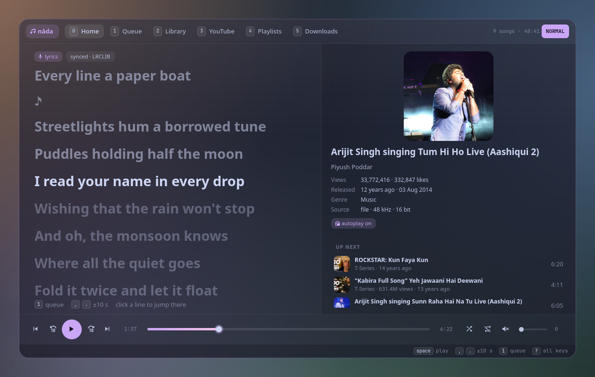
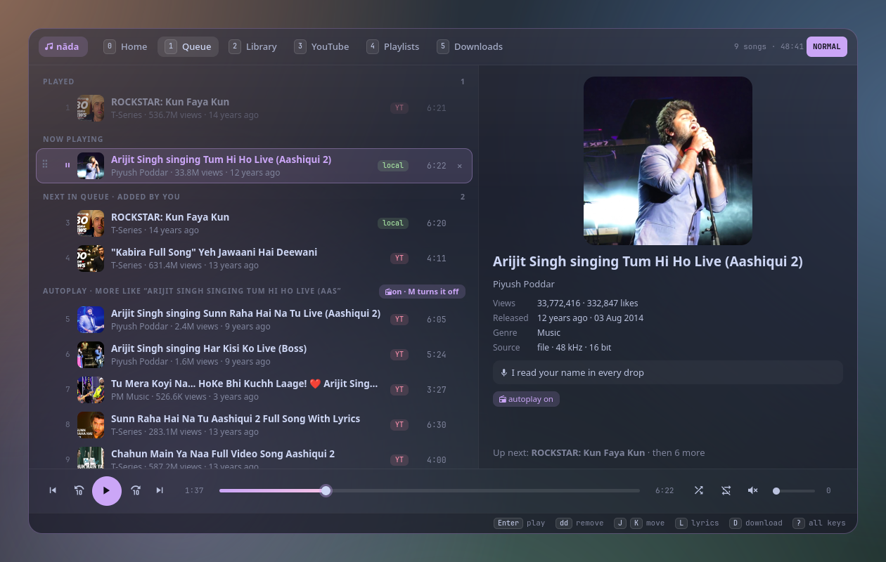
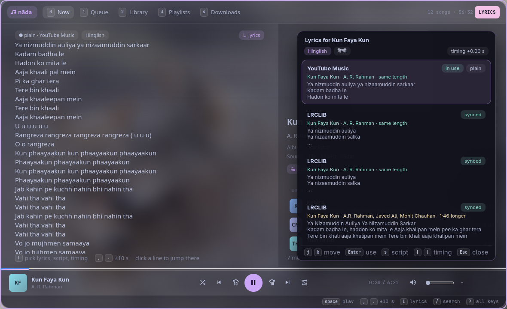
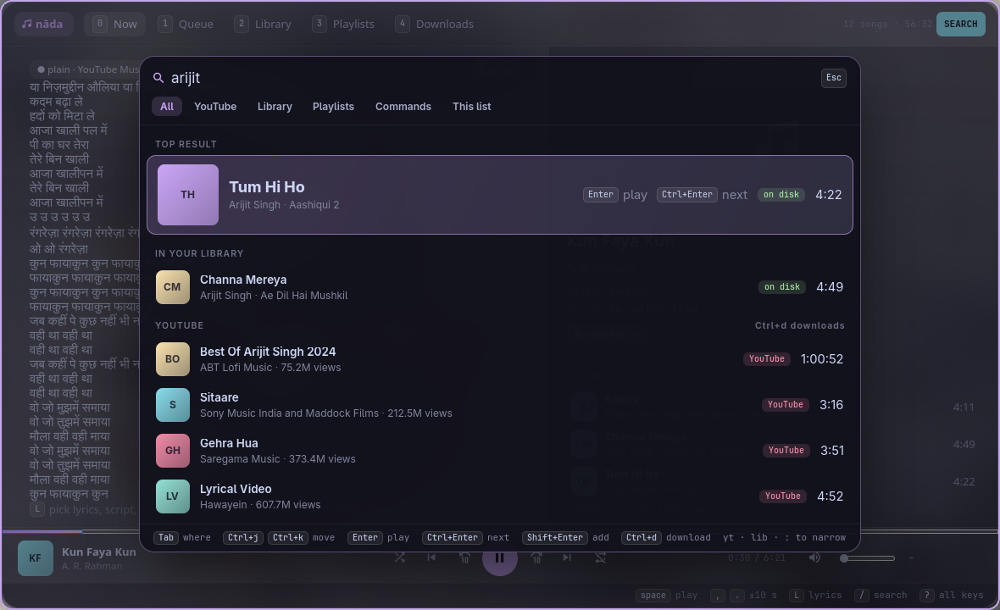
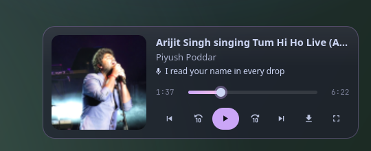
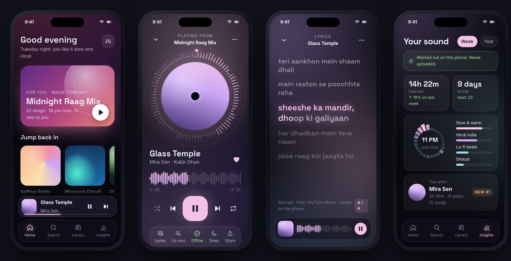
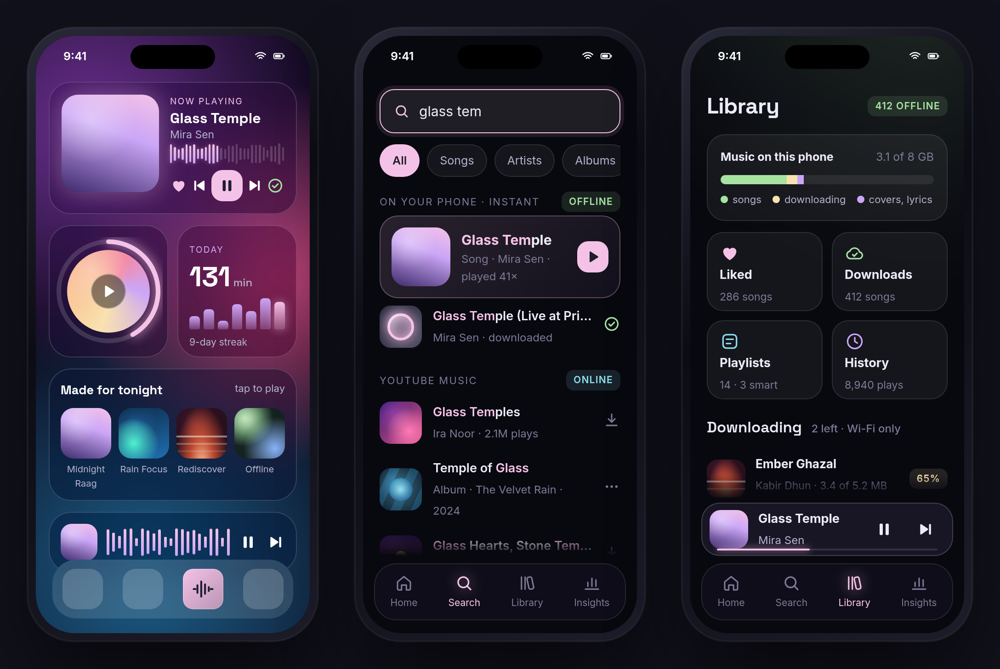

<p align="center">
  <picture>
    <source media="(prefers-color-scheme: dark)" srcset="assets/banner-dark.svg">
    <source media="(prefers-color-scheme: light)" srcset="assets/banner-light.svg">
    
  </picture>
</p>

<!-- identity -->
<p align="center">
  <b>चैतन्यं सर्वभूतानां विवृत्तं जगदात्मना ।<br>
  नादब्रह्म तदानन्दमद्वितीयमुपास्महे ॥</b><br>
  <i>The awareness in all beings, unfolded as the world: we honour it as Brahman in sound, joy without a second.</i><br>
  <sub>Saṅgīta Ratnākara 1.3.1</sub>
</p>
<!-- /identity -->

<p align="center">
  <b>A music player for your desktop and your phone: your files and YouTube Music, with synced lyrics, autoplay and downloads.</b><br>
  On Linux: vim keys for everything, built on MPD, styled like glass.<br>
  On Android: no account, everything kept on the phone, a feed that learns what you like.
</p>

<p align="center">
  <a href="https://github.com/Theyashsawarkar/nada/actions/workflows/ci.yml"></a>
  <a href="https://github.com/Theyashsawarkar/nada/releases"></a>
  <a href="LICENSE"></a>
  
  
  
</p>

<p align="center">
  
</p>

> *Nāda* (नाद) is Sanskrit for "sound": in Indian music theory, the
> primordial sound every note comes from.

nāda is a music player for people who live on the keyboard. Songs on your
disk and music from YouTube share one queue. Play a song and, like YouTube,
nāda lines up what comes next; reorder or remove anything with vim keys.
Lyrics scroll along with the song. If you like a YouTube song, `D` saves it
to your music folder, with its tags, cover and lyrics, while it keeps
playing. It runs on [MPD](https://www.musicpd.org), so your library, queue
and playback carry on with the window closed. Its phone side, [nāda for
Android](#on-your-phone), brings the same music to your pocket.

## Download

<div class="cards">
<a class="card" href="#install"><div class="n">Linux · GTK 4 · MPD</div><h3>nāda for the desktop</h3><p>The keyboard-driven player: your files and YouTube in one queue, synced lyrics, a floating mini player. Install it with git in two lines.</p><p><b>Install on Linux →</b></p></a>
<a class="card" href="https://github.com/Theyashsawarkar/nada/releases"><div class="n">Android · APK · coming soon</div><h3>nāda for your phone</h3><p>YouTube Music with no account, history and a feed that learn you on the phone, home-screen widgets. The APK will be on the Releases page.</p><p><b>Download the APK →</b></p></a>
</div>

## Contents

- [Download](#download)
- [Features](#features)
- [On your phone](#on-your-phone)
- [Install](#install)
- [Usage](#usage)
- [Keys](#keys)
- [Commands](#commands)
- [Configuration](#configuration)
- [Desktop integration](#desktop-integration)
- [How it works](#how-it-works)
- [Troubleshooting](#troubleshooting)
- [Contributing](#contributing)
- [License](#license)

## Features

- **Search everything from one key.** `/` opens a floating search over
  whatever you're on: your library answers as you type, YouTube a moment
  later, with the best match on top; `Tab` picks where to look (YouTube,
  library, playlists, commands, the list you're on). Play, play next, add
  or download without leaving the box.
- **Now is the lyrics.** The window opens on the playing song's lyrics,
  large, the current line lit and centred, scrolling with the song. Click a
  line to jump there. On the right: the cover, the song's **real name and
  artists** (from YouTube Music, not the upload's title), the album, views,
  and what's next.
- **Lyrics that show up.** Looked up in YouTube Music first (by the video
  itself: synced lyrics licensed from LyricFind), then LRCLIB and NetEase;
  a `.lrc` next to the file or lyrics in its tags come first. A source
  that can't be reached is asked again in 30 s, never remembered as "no
  lyrics". Hindi lyrics show in Latin letters (Hinglish) or Devanagari.
  `L` opens the lyrics panel: every version the sources have, which one
  fits the song's length, `[` `]` to fix the timing, `s` for the script.
- **Up next, like YouTube.** Playing a YouTube song lines up YouTube's own
  mix for it; a song from your library brings the rest of its album and
  more by that artist. The queue shows what you added and what autoplay
  added separately, refills itself as it runs low, and `M` turns it off.
- **Your queue, edited like text.** `dd` removes, `J`/`K` move a song,
  `yy`/`p` copy and paste, `V` selects several, `u` undoes, `Ctrl+r`
  redoes, and you can drag rows by their handle or click × to remove one.
- **Seek anywhere.** `,` and `.` skip 10 seconds (`3.` skips 30), the ⟲ ⟳
  buttons do the same, and the progress bar is clickable.
- **YouTube without an account.** Search it from `/`; every result shows
  its views and age, and "All YouTube results" opens the full list. Stream links expire after a few hours, so nāda remembers
  the video, not the link, and renews it before it plays.
- **Download what you like.** `D` saves a YouTube song as Opus (what
  YouTube streams, so nothing is re-encoded) into
  `~/Music/YouTube/<Artist>/<Title>.opus`, with tags, cover art and a
  `.lrc` lyrics file. When it finishes, the queue entry is swapped for the
  file in place, and playback carries on from the same second.
- **Your library in columns**, like yazi: artists, albums, genres or
  folders (`Tab`), `h`/`l` between columns, `/` searches everything.
- **Playlists** that mix files and YouTube songs: `:w name` saves the
  queue, `:e name` loads one.
- **A mini player** (`z`) in the corner, with the current lyric line.
- **Everywhere on the desktop**: MPRIS for media keys, `playerctl` and your
  phone (KDE Connect); a waybar module; `nada ctl` for scripts and key
  bindings; a notification with the cover when the song changes.
- **Never freezes**: anything slow (YouTube, lyrics, covers) runs in the
  background.

<p align="center">
  
  
</p>
<p align="center">
  
  
</p>

## On your phone

<p align="center">
  
</p>

nāda for Android is the same player made for a phone: dark glass over
colour taken from the cover that's playing, with pink always marking
where you are. **There is nothing to sign in to and no server.** Songs
come from YouTube Music, and everything else stays on the phone.

- **A feed that learns you, on the phone.** Every play is a row in a
  SQLite database on the phone. Finishing, replaying, liking or
  downloading a song counts for it, skipping it early counts against it,
  and older plays slowly count less. Home is built from that, mixed with
  YouTube Music's own "related" songs: mixes for the time of day,
  "More like" your most-replayed song, "Rediscover" what you loved a
  month ago. Each row says why it's there.
- **Offline first.** YouTube Music is the only thing the app talks to.
  Song details, covers, lyrics and related lists are kept once fetched;
  with no signal, Home and search use your downloads and history.
- **Search that answers at once.** Your history and downloads answer
  while you type, even in airplane mode; YouTube Music answers below.
- **Lyrics, large and in time**, the sung line lit, Hindi in Latin
  letters or Devanagari, as on the desktop.
- **Insights:** listening time, streaks, top artists, moods and the hours
  you listen at, worked out on the phone and never uploaded.
- **Downloads** keep their cover, lyrics and tags; Wi-Fi only by default.

<p align="center">
  
</p>

**Widgets:** Now playing (4×2), Orb (2×2), Today (2×2), Made for tonight
(4×2) and Pulse (4×1), plus the playing song on the lock screen and the
always-on display. Each plays, pauses and skips without opening the app.

The Android app is being built (Expo and React Native, with SQLite on the
phone); the screens above are its design. The first APK will be on the
[Releases](https://github.com/Theyashsawarkar/nada/releases) page.

## Install

### Android

Download `nada.apk` from the [Releases](https://github.com/Theyashsawarkar/nada/releases)
page on your phone and open it (Android asks once to allow installs from
your browser). It updates the same way. The first APK isn't out yet.

### Linux: what it needs

- Python 3.11+, PyGObject, GTK 4
- [MPD](https://www.musicpd.org) (the engine: it plays, keeps the queue and indexes your music)
- [yt-dlp](https://github.com/yt-dlp/yt-dlp) for YouTube, and ffmpeg for downloads
- [python-ytmusicapi](https://github.com/sigma67/ytmusicapi) for lyrics from YouTube Music and songs' real names (without it, LRCLIB and NetEase only)
- optional: [gtk4-layer-shell](https://github.com/wmww/gtk4-layer-shell) (the mini player floats in a corner), mutagen (tags on downloads), a [Nerd Font](https://www.nerdfonts.com) for the icons

```sh
# Arch
sudo pacman -S --needed python-gobject gtk4 mpd yt-dlp ffmpeg python-ytmusicapi python-mutagen gtk4-layer-shell ttf-jetbrains-mono-nerd
systemctl --user enable --now mpd
```

MPD needs a `music_directory` and an audio output; the [Arch wiki](https://wiki.archlinux.org/title/Music_Player_Daemon)
has a five-line config. nāda finds MPD the way every MPD client does:
`MPD_HOST` / `MPD_PORT`, else MPD's socket in `$XDG_RUNTIME_DIR/mpd/socket`,
else `localhost:6600`.

### Linux: nāda

```sh
git clone https://github.com/Theyashsawarkar/nada ~/.local/share/nada
ln -s ~/.local/share/nada/bin/nada ~/.local/bin/nada
nada            # opens the player (it starts itself the first time)
```

Update with `git -C ~/.local/share/nada pull && nada quit`.

## Usage

```
nada                       open the player, or close it if it's open
nada show | hide | mini    the full player, hidden, the mini player
nada tab <name>            open on a tab: home queue library youtube playlists downloads
nada add [--next|--play] <YouTube URL | file | search words>
nada ctl toggle|play|pause|stop|next|prev
nada ctl seek +10 | seek -10 | seek 1:30
nada ctl vol +5 | vol -5 | vol 40
nada status [--json]       what's playing
nada waybar                JSON for a waybar module
nada daemon | quit         start / stop the player (MPD keeps playing)
```

The player is one resident process; `nada` only sends it a D-Bus message,
so it opens at once. `ctl`, `status` and `waybar` talk to MPD directly and
work even when the player isn't running. Closing the window (`q`, `Esc`)
only hides it: the music, autoplay and downloads carry on.

## Keys

nāda is vim-driven, with `Space` as the leader, the same grammar as every
Vayu tool: a key you use all the time is one key (`j`/`k`, `p` play/pause,
`H`/`L` tabs, `dd`, `yy`); everything else is `Space`, then a group, then
the thing (`Space p s` shuffle, `Space t l` the library). Wait a moment after
`Space` (or `g`, `d`, `y`) and a strip shows what can come next; `Esc`
cancels. `Space Space` opens a palette of every action, `?` or `Space ?`
shows every key of the tab you're on. Counts work like vim: `5j`, `3.`,
`2dd`; digits are always counts (tabs are `H`/`L`, `Space t`, `Ctrl+0..4`).
While typing, `Ctrl+j`/`Ctrl+k` move. Confirmations take `y` only.

Moved in this release (the old key says where, then goes away):
`Space` play/pause is `p`; queue paste `p`/`P` is `gp`/`gP`; `s` shuffle is
`Space p s`; `r` repeat is `Space p r` (`r` now refreshes); `L` lyrics is
`Space u l` (`L` is the next tab); `i` info is `Space i`; `zz` is
`Space g p`; a lone `0`-`4` is `H`/`L` or `Space t`.

<!-- keys: generated by scripts/keybinds.py from the keymap; don't edit by hand -->

**Everywhere**

| Key | Action |
|---|---|
| `j` | Move down a song (counts work: 5j) |
| `k` | Move up a song |
| `g g` | Jump to the top (12gg: to the 12th) |
| `G` | Jump to the bottom (12G: to the 12th) |
| `Ctrl+d` | Scroll half a page down |
| `Ctrl+u` | Scroll half a page up |
| `H` | Switch to the previous tab (wraps around) |
| `L` | Switch to the next tab (wraps around) |
| `Ctrl+Tab` | Switch to the next tab (also from the search box) |
| `Ctrl+Shift+Tab` | Switch to the previous tab (also from the search box) |
| `Ctrl+0` | Switch to Now at once (Ctrl+1 Queue, 2 Library, 3 Playlists, 4 Downloads) |
| `p` | Toggle play / pause |
| `Enter` | Play the selected song |
| `.` | Seek forward 10 seconds (3. = 30 s) |
| `,` | Seek back 10 seconds |
| `>` | Play the next song |
| `<` | Play the previous song |
| `=` | Raise the volume |
| `-` | Lower the volume |
| `m` | Toggle mute |
| `M` | Toggle autoplay (more like this after your songs) |
| `V` | Select several songs (visual mode) |
| `u` | Restore the last change (undo) |
| `Ctrl+r` | Restore an undone change (redo) |
| `D` | Save the playing YouTube song to your music folder (download) |
| `r` | Refresh: rescan the music folder and reload the lists |
| `/` | Open the search panel (your library, YouTube, playlists, : commands, this list) |
| `o` | Open the search panel to paste a YouTube link |
| `:` | Run a command (:w name, :sleep 30m, :yt query…) |
| `?` | Show every key of this tab |
| `z` | Switch to the mini player |
| `q` | Close the window (the music keeps playing) |
| `Esc` | Go back, or close the window |
| `s` | Show where shuffle moved (Space p s; for one release) |
| `i` | Show where song info moved (Space i; for one release) |
| `0` | Show where the tab numbers moved (H / L, Space t; for one release) |
| `Space Space` | Open the palette (every action of this tab, fuzzy) |
| `Space ?` | Show every key of this tab |
| `Space q` | Close the window (the music keeps playing) |
| `Space t n` | Switch to Now (the lyrics) |
| `Space t q` | Switch to the queue |
| `Space t l` | Switch to the library |
| `Space t p` | Switch to playlists |
| `Space t d` | Switch to downloads |
| `Space u l` | Toggle the lyrics on the right (Now: open the lyrics panel) |
| `Space u m` | Switch to the mini player |
| `Space p s` | Toggle shuffle |
| `Space p r` | Cycle repeat (off, all, this song) |
| `Space p a` | Toggle autoplay (more like this after your songs) |
| `Space p z` | Toggle the sleep timer (fades out in 30 min) |
| `Space l l` | Open the lyrics panel (pick a version, the script, the timing) |
| `Space l s` | Switch the lyrics script: Hinglish (Latin letters) or Devanagari |
| `Space l [` | Show the lyrics earlier by 0.25 s (kept for the song) |
| `Space l ]` | Show the lyrics later by 0.25 s (kept for the song) |
| `Space y y` | Copy the playing song's title and artist |
| `Space y l` | Copy the playing song's link (YouTube) or file path |
| `Space f f` | Search everything |
| `Space f y` | Search YouTube |
| `Space f l` | Search your library |
| `Space f p` | Search your playlists |
| `Space f c` | Search the : commands |
| `Space f t` | Search this list |
| `Space x d` | Save the song to your music folder (download) |
| `Space i` | Show the song's title, artist and link |
| `Space g p` | Go to the song that's playing (in the queue) |
| `Space o b` | Open the playing song on YouTube in the browser |
| `Space r` | Refresh: rescan the music folder and reload the lists |
| `Space d c` | Clear the queue (asks first; u brings it back) |

**Queue**

| Key | Action |
|---|---|
| `d d` | Remove the song from the queue (2dd: two; u undoes it) |
| `x` | Remove the song from the queue (like dd; u undoes it) |
| `d G` | Remove every song from here to the end (u undoes it) |
| `y y` | Copy the song (yank; 3yy: three) |
| `g p` | Paste removed or copied songs below |
| `g P` | Paste removed or copied songs above |
| `J` | Move the song down |
| `K` | Move the song up |
| `A` | Move the song to play next |
| `D` | Save the YouTube song to your music folder (download; V: the selection) |
| `n` | Jump to the next match (after a "This list" search) |
| `N` | Jump to the previous match |
| `Space d d` | Remove the song from the queue (u undoes it) |

**Library**

| Key | Action |
|---|---|
| `h` | Move to the column on the left |
| `l` | Move to the column on the right |
| `Tab` | Switch between artists, albums, genres and folders |
| `Enter` | Play the artist, album or song (replaces the queue) |
| `a` | Add to the end of the queue |
| `A` | Add to play next |
| `Space a a` | Add to the end of the queue |
| `Space a n` | Add to play next |

**YouTube results**

| Key | Action |
|---|---|
| `Enter` | Play the result |
| `a` | Add the result to the end of the queue |
| `A` | Add the result to play next |
| `D` | Save the result to your music folder (download) |
| `Space a a` | Add the result to the end of the queue |
| `Space a n` | Add the result to play next |

**Playlists**

| Key | Action |
|---|---|
| `h` | Move to the playlists |
| `l` | Move to the playlist's songs |
| `Enter` | Play the playlist (replaces the queue) |
| `a` | Add the playlist to the end of the queue |
| `A` | Add the playlist to play next |
| `d d` | Delete the playlist (asks first) |
| `D` | Save the playlist's YouTube songs to your music folder (download) |
| `Space a a` | Add the playlist to the end of the queue |
| `Space a n` | Add the playlist to play next |
| `Space d d` | Delete the playlist (asks first) |

**Downloads**

| Key | Action |
|---|---|
| `Enter` | Play the saved song |
| `R` | Retry a failed download |
| `d d` | Delete the saved file (asks first) |
| `Space x r` | Retry a failed download |
| `Space d d` | Delete the saved file (asks first) |

**Now**

| Key | Action |
|---|---|
| `Enter` | Toggle play / pause |

**Queue, visual mode (V)**

| Key | Action |
|---|---|
| `d` | Remove the selected songs (u undoes it) |
| `x` | Remove the selected songs (like d; u undoes it) |
| `y` | Copy the selected songs (yank) |
| `D` | Save the selected YouTube songs (download) |
| `V` | Leave visual mode |
| `Esc` | Leave visual mode |

**YouTube results, visual mode (V)**

| Key | Action |
|---|---|
| `a` | Add the selected results to the end of the queue |
| `A` | Add the selected results to play next |
| `D` | Save the selected results (download) |
| `V` | Leave visual mode |
| `Esc` | Leave visual mode |

**Lyrics panel (Space l l)**

| Key | Action |
|---|---|
| `j` | Move down through the versions the sources have |
| `k` | Move up through the versions |
| `Enter` | Use these lyrics (kept for the song) |
| `s` | Switch the script: Hinglish (Latin letters) or Devanagari |
| `[` | Show the lyrics earlier by 0.25 s (kept for the song) |
| `]` | Show the lyrics later by 0.25 s (kept for the song) |
| `Esc` | Close the lyrics panel (q too) |

**Search panel (/)**

| Key | Action |
|---|---|
| `Tab` | Switch where to look (all, YouTube, library, playlists, commands, this list) |
| `Shift+Tab` | Switch back where to look |
| `Ctrl+j` | Move down through the results while typing |
| `Ctrl+k` | Move up through the results while typing |
| `Enter` | Play the result (a playlist: replace the queue; a command: run it) |
| `Ctrl+Enter` | Play the result next |
| `Shift+Enter` | Add the result to the end of the queue |
| `Ctrl+d` | Download the result (YouTube) |
| `Ctrl+u` | Clear the search box |
| `Ctrl+x` | Clear recent searches |
| `Esc` | Close the search panel |

**Palette (Space Space)**

| Key | Action |
|---|---|
| `Ctrl+j` | Move down through the actions (Down too) |
| `Ctrl+k` | Move up through the actions (Up too) |
| `Enter` | Run the action |
| `Esc` | Close the palette |

**While a key waits**

| Key | Action |
|---|---|
| `Esc` | Cancel a pending key or count (Space, g, d…) |

<!-- end of keys -->

**Mini player (`z`)**

| Key | Action |
|---|---|
| `Space` | Toggle play / pause |
| `. / ,` | Seek forward / back 10 seconds |
| `> / <` | Play next / previous song |
| `z / Enter` | Switch back to the full player |
| `q / Esc` | Close the mini player (the music keeps playing) |

## Commands

Typed after `:`, like vim.

| Command | Does |
|---|---|
| `:w <name>` | Save the queue as a playlist (YouTube songs included) |
| `:e <name>` | Replace the queue with a playlist (`:e` alone opens Playlists) |
| `:yt <search>` | Play the top YouTube result, and its mix after it |
| `:play <search>` | Play a song from your library (falls back to YouTube) |
| `:add <url or search>` | Add to the end of the queue |
| `:seek 1:30` · `:seek +30` | Jump to a time, or by an amount |
| `:vol 40` · `:vol +10` | Set or change the volume |
| `:sleep 30m` · `:sleep off` | Fade out and pause after a while |
| `:lyrics <search>` | Pick the lyrics by hand (remembered for the song) |
| `:autoplay on` · `off` | Same as `M` |
| `:dl` | Download the playing song |
| `:clear` | Empty the queue (`u` brings it back) |
| `:q` · `:qa` | Hide the window · quit the player |

## Configuration

Everything is optional, in `~/.config/nada/config.toml`:

```toml
[nada]
autoplay = true          # line up more songs after yours (M toggles it, and it's remembered)
download_dir = "YouTube" # inside MPD's music directory
format = "opus"          # opus (no re-encoding) | mp3 | m4a
seek_step = 10           # seconds for , and .
volume_step = 5
notify = true            # a notification when the song changes (while the window is hidden)
opacity = 0.62           # window background: 1 is solid, lower shows the blur behind it
                         # (unset: your varna theme's panel glass, so it matches Vyom's panels)
music_dir = ""           # default: MPD's music_directory
```

`~/.config/nada/style.css` is loaded last, to restyle anything (the default
look is Catppuccin Mocha with a mauve accent: see `nada/style.css`). With
[varna](https://github.com/Theyashsawarkar/varna) installed, nāda takes the
current theme's colours instead (`varna tool nada <theme>` gives it its own)
and restyles as soon as the theme changes.

## Desktop integration

**sway** (the same works with any compositor's key bindings):

```sh
exec nada daemon
bindsym $mod+Shift+m exec nada                       # open / hide
bindsym $mod+Mod1+space exec nada ctl toggle          # without opening anything
bindsym $mod+Mod1+period exec nada ctl next
bindsym $mod+Mod1+comma exec nada ctl prev
for_window [app_id="^dev\.vayu\.Nada$"] floating enable, resize set 1180 720, move position center
```

Media keys going through `playerctl` work as they are: nāda speaks MPRIS.
On SwayFX, `blur enable, corner_radius 20` in that `for_window` rule gives
the window its glass look; the mini player is a layer-shell surface named
`nada` (`layer_effects "nada" { blur enable; corner_radius 18; }`).

**waybar**, a module that shows what's playing (and disappears when
nothing is):

```jsonc
"custom/nada": {
  "exec": "nada waybar",
  "return-type": "json",
  "on-click": "nada ctl toggle",
  "on-click-middle": "nada ctl next",
  "on-click-right": "nada",
  "on-scroll-up": "nada ctl seek +10",
  "on-scroll-down": "nada ctl seek -10"
}
```

Its `class` is `play`, `pause` or `stopped`, to style each state.

**From other tools**: `nada add --play <url>` plays a YouTube link with its
mix after it; [raga](https://github.com/Theyashsawarkar/raga), the YouTube
search panel, uses exactly that.

## How it works

```
 raga, keys, waybar ──► nada (bin/nada: D-Bus) ──► the player process ──► MPD ──► speakers
                                                    │
                                                    ├─ yt-dlp: search, mixes, stream links, downloads
                                                    ├─ LRCLIB: lyrics
                                                    └─ MPRIS: media keys, phone, playerctl
```

- `nada/core.py` is the model: MPD's queue and state, plus what MPD doesn't
  do (YouTube songs and their expiring links, autoplay, undo, downloads,
  lyrics, covers). Slow work runs on worker threads and reports back on
  the GTK main loop.
- `nada/window.py` is the window and the vim key engine (modes, counts,
  pending operators, registers); `nada/views.py` the six tabs and the right
  pane; `nada/mini.py` the mini player; `nada/mpris.py` MPRIS.
- YouTube songs sit in MPD's queue as stream URLs, tagged with their video
  id, so other MPD clients see and play them too.

## Troubleshooting

- **"MPD isn't running".** `systemctl --user start mpd` (and `enable` it).
  nāda reconnects by itself.
- **No sound but it says it's playing.** That's MPD's audio output: check
  `audio_output` in your `mpd.conf` (PipeWire users: `type "pipewire"` or
  `"pulse"`).
- **"Volume control unavailable".** Your MPD output has no mixer; set
  `mixer_type "software"` in its `audio_output` block.
- **A YouTube song won't play.** Update yt-dlp first (`yt-dlp -U`, or your
  package manager): YouTube changes often and yt-dlp follows.
- **Wrong or missing lyrics.** `:lyrics <artist> <song>` picks them by hand.
- **Anything else.** The player's log has the details: `journalctl --user -u nada -u nada-daemon -b` (without systemd: `~/.local/state/nada/daemon.log`);
  please [open an issue](https://github.com/Theyashsawarkar/nada/issues/new/choose) with it.

## Contributing

Bug reports, ideas and pull requests are welcome: see
[CONTRIBUTING.md](CONTRIBUTING.md) for the development setup and the rules
the code follows, and [CHANGELOG.md](CHANGELOG.md) for what changed in each
release. Please report security issues privately ([SECURITY.md](SECURITY.md)).

nāda is part of [Vayu](https://github.com/Theyashsawarkar/vayu), a
keyboard-driven Wayland desktop, and works on its own on any desktop with
MPD.

## License

[MIT](LICENSE)
